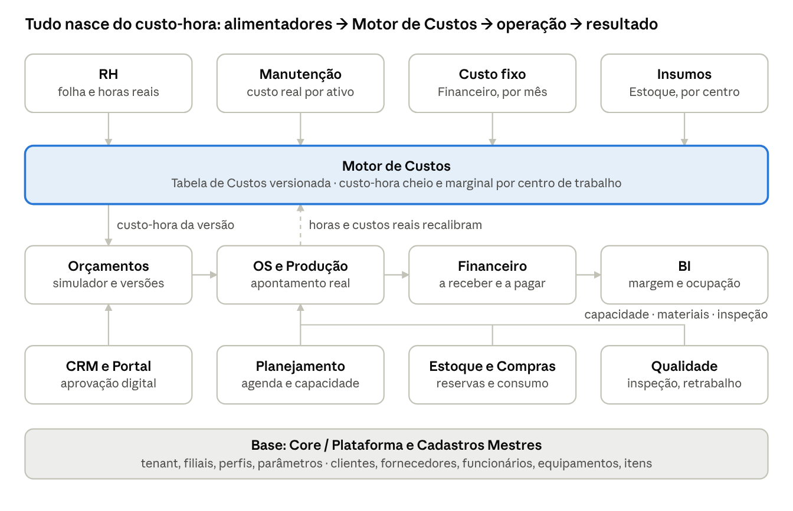
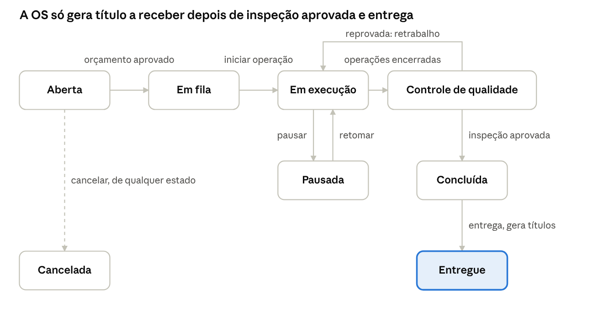
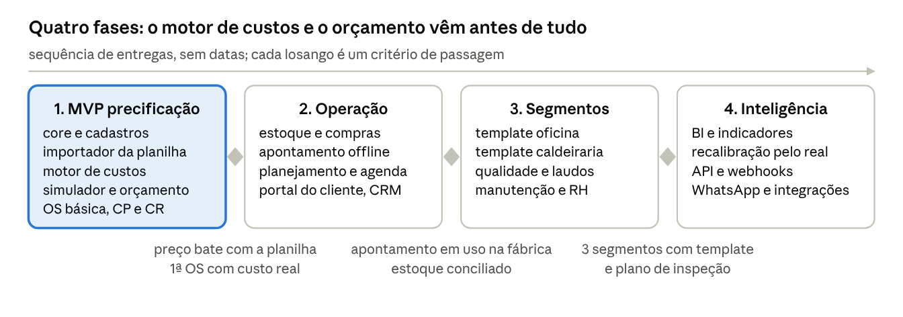

# SPEC — ERP Multi-Segmento com Motor de Precificação por Custos Reais

09/10/2026 · Guilherme de Souza Dortas Matos · v1.1 (12/10/2026: identidade visual Aço & Fagulha, telas de cadastro e cadastro conversacional)

## 1. Visão geral

O produto é um ERP de gestão e ordens de serviço para oficinas mecânicas (motos e carros), usinagem e caldeiraria, cujo núcleo é um motor de precificação por custos reais. Cada hora de máquina ou de técnico tem um custo calculado a partir de salário, encargos, manutenção, insumos, depreciação, energia e rateio do custo fixo; todo orçamento, OS e indicador de margem nasce desse custo-hora.

### Segmentos atendidos

| Segmento | Objeto da OS | Recurso que gera custo-hora | O que muda na operação |
| --- | --- | --- | --- |
| Oficina de motos e carros | Veículo (placa, km, histórico) | Mecânico, box/elevador, bancada | Checklist de entrada com fotos, peças de reposição com margem própria, mão de obra por tempo padrão, garantia de serviço |
| Usinagem | Peça ou lote (desenho, revisão, material, tolerância) | Máquina CNC/convencional + operador | Setup diluído no lote, tempo de ciclo por peça, ferramental específico, inspeção dimensional, certificado de material |
| Caldeiraria | Projeto/estrutura (lista de materiais em kg, consumíveis de solda) | Soldador/caldeireiro + equipamento (solda, plasma, dobradeira) | Aço por kg, hora-homem dominante, etapas corte → dobra → solda → montagem → pintura, inspeção de solda, montagem em campo |

### Diferencial competitivo

- Preço explicável: cada valor do orçamento mostra sua composição (material, hora-máquina, setup, rateio, impostos, margem).
- Ciclo fechado: o apontamento real da OS confronta o orçado e recalibra tempos e custos para o próximo orçamento.
- Um só sistema para três operações diferentes, com telas, templates e regras ligados por perfil de segmento.
- Interface com cara de chão de fábrica e fala de gente da oficina (identidade **Aço & Fagulha**, seção 16): clara, colorida, explicando o porquê de cada número e dizendo o próximo passo, em vez de mensagens de sistema.

### Princípios de arquitetura

1. **Centro de Trabalho como abstração única.** Máquina, box, bancada, célula de solda e técnico em campo são centros de trabalho; o custo-hora é propriedade do centro, não da tela.
2. **Custo versionado, nunca recalculado ao vivo.** O custo-hora vive em uma Tabela de Custos com versão por competência; orçamentos e OS referenciam a versão usada.
3. **Orçado × Realizado em toda entidade.** Horas, materiais, terceiros e custo têm sempre o par estimado/real.
4. **Perfil de segmento, não produto separado.** Mesma base de código; o tenant ativa OFICINA, USINAGEM, CALDEIRARIA ou MISTO, que liga campos, telas, templates de orçamento e regras.
5. **Monólito modular orientado a eventos.** Módulos são bounded contexts com contratos explícitos e comunicação por eventos de domínio, extraíveis para serviços quando a escala exigir.
6. **Financeiro gerencial, sem fiscal.** O sistema não emite documentos fiscais; opera contas a pagar, contas a receber e fluxo de caixa. Impostos entram apenas como percentual na formação de preço.
7. **Automação com aceite humano.** Recálculos, recalibrações e sugestões são propostos e registrados; publicar uma nova versão de custo é sempre uma ação consciente do gestor.

## 2. Análise da planilha de referência

A planilha PRECIFICAÇÃO EM USINAGEM (4 abas + aba de exemplo) implementa exatamente a cadeia custo fixo → custo específico da máquina → custo-hora cheio → simulador, e o motor do sistema generaliza essa lógica sem alterar a regra de negócio.

### O que cada aba calcula

| Aba | Entradas | Saída | Valores no exemplo da planilha |
| --- | --- | --- | --- |
| 1. Custo fixo da fábrica | 18 itens de despesa mensal (água, alarme, aluguel, contabilidade, luz, pessoal administrativo e comercial, pró-labore, seguros, sistemas, tarifas, taxas bancárias, telefone, treinamentos, outros), nº de máquinas produtivas, horas de expediente (220 h CLT), eficiência (75%) | Custo fixo total e taxa de chão de fábrica (R$/h) | 22.000 ÷ (3 máquinas × 165 h) = R$ 44,44/h |
| 2. Custo específico da máquina | Salário bruto do operador, encargos e benefícios, manutenção média mensal, insumos médios (óleo, ferramentaria geral), depreciação (valor ÷ 60), energia elétrica (deixada em zero: "consulte o desenvolvedor") | Custo direto mensal e custo específico por hora | 5.000 + 3.200 + 700 + 700 + 2.500 = 12.100 ÷ 165 h = R$ 73,33/h |
| 3. Custo final hora | Taxa de chão de fábrica + custo específico | Custo-hora cheio do equipamento | 44,44 + 73,33 = R$ 117,78/h |
| 4. Simulador de preços | Produto, tamanho do lote, linhas de matéria-prima, ferramentas especiais, horas de uso e de setup por equipamento (até 3), % impostos, % margem | Custo total, custo unitário e preço unitário | 117,78 ÷ (1 − 0,14 − 0,20) = R$ 178,45 |

### Fórmulas base (como estão na planilha)

```math
H_{reais} = H_{expediente} \times \eta
```

```math
T_{rateio} = \frac{CF_{total}}{N_{maq} \times H_{reais}}
```

```math
CH_{esp} = \frac{Sal + Enc + Man + Ins + Dep + Energia}{H_{reais}}, \qquad Dep = \frac{V_{aquisicao}}{60}
```

```math
CH_{cheio} = T_{rateio} + CH_{esp}
```

```math
C_{lote} = \sum MP + \sum Ferr + \sum_{eq} h_{uso} \cdot CH_{cheio} + \sum_{eq} h_{setup} \cdot CH_{cheio}
```

```math
P_{unit} = \frac{C_{lote} / Q_{lote}}{1 - i - m}
```

O preço é formado pelo método divisor: impostos e margem incidem "por dentro", sobre o preço, e não como markup somado ao custo. Esse é o método padrão do motor; o markup multiplicador fica disponível por parâmetro.

### Limitações da planilha e decisões de projeto do motor

| Limitação na planilha | Decisão no motor |
| --- | --- |
| Custo fixo dividido igualmente entre N máquinas | Critério de rateio configurável por centro de trabalho: horas reais, valor do ativo, área ocupada, faturamento histórico ou percentual manual |
| Um operador por máquina, 100% alocado | Alocação N:N com fator (%) por operador e centro; máquina sem operador dedicado (oficina) e operador que atende duas máquinas |
| Energia elétrica em zero | Potência (kW) × fator de carga × tarifa (R$/kWh) × horas reais, por centro de trabalho |
| Depreciação fixa em 60 meses, sem valor residual | Vida útil e valor residual por ativo; ativo totalmente depreciado continua com "reserva de reposição" opcional |
| Eficiência única para a fábrica (75%) | Eficiência por centro de trabalho e por turno, recalibrada pelo apontamento real |
| Impostos como percentual único | Percentual sugerido pelo regime tributário e pelo tipo de linha (serviço × peça), editável, sem apuração fiscal |
| Sem histórico: alterar o custo fixo muda orçamentos antigos | Tabela de Custos versionada por competência; orçamento e OS guardam a versão usada |
| Máximo de 3 equipamentos por orçamento | Linhas ilimitadas, roteiro de operações por peça |
| Só máquina gera custo-hora | Centro de trabalho do tipo "mão de obra" (mecânico, soldador) com custo-hora próprio |
| Setup diluído só pela divisão do total pelo lote | Setup explícito por lote, com curva de preço por quantidade (1, 10, 50, 100 peças) |
| Sem terceiros, frete, comissão, desconto | Linhas de serviço externo, frete e comissão; desconto recalcula a margem efetiva |
| Manutenção e insumos digitados "na média" | Médias propostas pelo histórico real (contas a pagar e consumo de insumos por centro), com aceite do gestor |

Critério de aceite do motor: com os mesmos parâmetros da planilha (3 centros iguais, rateio por horas reais, 220 h, 75%, depreciação em 60 meses, energia zero), o sistema reproduz R$ 44,44/h, R$ 73,33/h, R$ 117,78/h e R$ 178,45 ao centavo.

## 3. Mapa de módulos



RH, Manutenção, Financeiro e Estoque alimentam o Motor de Custos; o custo-hora versionado desce para o Orçamento, a OS devolve horas e custos reais para recalibrar, Planejamento, Estoque e Qualidade servem a OS, e Financeiro e BI fecham o resultado sobre a base de Core e Cadastros.

## 4. Módulo 1 — Core / Plataforma

**Objetivo:** sustentar multi-tenancy, identidade, permissões, parametrização por segmento e os serviços transversais (auditoria, notificações, anexos, jobs, integrações) que todos os outros módulos consomem.

### Submódulos e funcionalidades

| Submódulo | Funcionalidades |
| --- | --- |
| Tenant e Empresa | Razão social, CNPJ, regime tributário (Simples, Presumido, Real — usado só para sugerir o % de impostos na precificação), logo, moeda, fuso; unidades/filiais com estoque, agenda e numeração próprios |
| Perfil de segmento | OFICINA, USINAGEM, CALDEIRARIA, MISTO; feature flags que ligam campos (placa/km, desenho/revisão, kg de aço), telas, templates de orçamento, planos de inspeção e textos de notificação |
| Usuários, perfis e permissões | RBAC com escopo por filial; perfis padrão: Administrador, Gerente, Orçamentista, Produção/Técnico, Compras, Financeiro, Recepção; permissões granulares: ver custo-hora, editar margem, aprovar desconto acima do limite, publicar Tabela de Custos, cancelar OS |
| Parâmetros globais | Horas de expediente padrão, eficiência padrão, vida útil padrão por categoria de ativo, margem mínima e alvo, % impostos padrão por tipo de linha, método de formação de preço (divisor/markup), arredondamento, validade de orçamento, tolerância de estouro de horas e materiais, limite do "serviço rápido" sem orçamento |
| Numeração e sequências | Séries por filial e por documento (ORC-2026-00001, OS-2026-00001, PC-2026-00001), sem furos, com prefixo configurável |
| Auditoria | Trilha imutável (quem, quando, valor anterior e novo) em custos, orçamentos, OS, estoque e financeiro; consulta por entidade e por usuário |
| Notificações | In-app, e-mail e WhatsApp (API oficial) com templates por evento e por segmento; preferências por usuário e por cliente |
| Anexos | Desenhos, fotos, PDFs, certificados em object storage, versionados e ligados à entidade (orçamento, OS, item, recebimento) |
| Importação/Exportação | Importador da planilha de precificação (custo fixo, máquinas, simulador) e de cadastros via CSV/XLSX; exportação de relatórios e extratos |
| Agendador de jobs | Fechamento mensal de custos, expiração de orçamentos, alertas de vencimento, recalibrações, lembretes de revisão |
| Integrações | API REST pública com OpenAPI, webhooks por evento de domínio, consulta de CNPJ/CEP/placa, gateway de WhatsApp |

### Regras de negócio

- O perfil de segmento define campos obrigatórios e visíveis; MISTO habilita tudo e escolhe o template pelo tipo de OS.
- Mudança de regime tributário ou de parâmetro de custo nunca altera dados retroativamente: gera proposta de nova versão da Tabela de Custos.
- Toda permissão sensível (ver custo-hora, aprovar desconto, publicar custo) é verificada no backend, não só na tela.
- Filial é dimensão de estoque, numeração, agenda e financeiro; cadastros (cliente, item, fornecedor, funcionário) pertencem ao tenant e podem ser restritos a filiais.
- Exclusão é sempre lógica (soft delete) em entidades referenciadas por orçamento, OS ou lançamento financeiro.

### Automações

- Onboarding guiado: importa a planilha atual e entrega a primeira Tabela de Custos pronta para publicação, já com os centros de trabalho criados.
- Alerta "parâmetro desatualizado" quando custo fixo, salários ou eficiência não são revisados há mais de N meses (padrão 3).
- Webhook e notificação por evento (orçamento aprovado, OS concluída, estoque mínimo, título vencido) configuráveis sem código.
- Troca de perfil de segmento roda uma checagem de impacto (campos que ficarão ocultos, templates que mudam) antes de aplicar.

## 5. Módulo 2 — Cadastros Mestres

**Objetivo:** ser a fonte única das entidades que todos os módulos usam, com os dados de custo já embutidos nos cadastros de funcionário, equipamento e item, para que o Motor de Custos não dependa de redigitação.

### Cadastros, campos-chave e regras

| Cadastro | Campos-chave | Regras e vínculos |
| --- | --- | --- |
| Cliente (PF/PJ) | Tipo, CPF/CNPJ, IE/IM, nome ou razão social e fantasia, contatos (vários, com papel: financeiro, técnico, aprovador), endereços de cobrança e entrega, condição e forma de pagamento padrão, limite de crédito, margem ou tabela especial, segmento, observações, status (ativo/bloqueado) | CPF/CNPJ validado e único por tenant; cliente bloqueado por inadimplência não recebe novo orçamento sem liberação; histórico de orçamentos, OS, veículos/ativos e títulos na própria ficha |
| Veículo (oficina) | Placa (Mercosul/antiga), chassi, marca/modelo/ano, motor e combustível, km atual, cor, proprietário | Placa única; km só avança (correção exige justificativa); troca de proprietário preserva o histórico de OS; lembrete de revisão por km ou tempo |
| Ativo do cliente (indústria) | Equipamento ou estrutura do cliente que recebe serviço: tag, descrição, local, desenhos, peças de reposição associadas | Vincula OS recorrentes, histórico de intervenções e peças ao ativo |
| Fornecedor | PF/PJ, categorias (matéria-prima, peças, ferramental, serviços externos), prazo médio de entrega, condição de pagamento, avaliação, itens fornecidos com último preço e data | Último preço alimenta a sugestão de custo no orçamento; avaliação e prazo alimentam o comparativo de cotações |
| Funcionário / Colaborador | Nome, função, tipo de vínculo (CLT, PJ, horista, sócio), salário bruto ou valor mensal, % de encargos (padrão por vínculo, editável), benefícios (VT, VR, plano, outros), jornada mensal (h), turno, habilitações (centros de trabalho que opera), % comissão, status | Custo mensal total e custo-hora calculados ao salvar; alteração salarial ou de jornada marca a Tabela de Custos como desatualizada; dados pessoais mínimos, acesso restrito ao perfil Financeiro/Admin |
| Equipamento / Centro de Trabalho | Tipo (máquina, box/elevador, bancada, célula de solda, equipamento móvel, mão de obra pura), categoria, valor de aquisição, data, vida útil (meses), valor residual, manutenção média mensal, insumos médios mensais, potência (kW) e fator de carga, horas disponíveis/mês, eficiência, operadores habilitados com % de alocação, peso de rateio, centro de custo, filial, status (ativo, em manutenção, desativado) | Depreciação e custo-hora calculados ao salvar; "em manutenção" retira capacidade da agenda; "desativado" sai do rateio; máquina sem operador alocado gera aviso |
| Item (produto/material) | Tipo (matéria-prima, peça de reposição, insumo/consumível, ferramenta geral, ferramenta específica, produto acabado, serviço externo), código, descrição, unidade de compra e de consumo com fator de conversão, densidade ou peso por metro (barras e chapas), custo médio, último custo, preço de venda ou margem, estoque mín/máx, fornecedor preferido, rastreável por lote (sim/não) | Insumo e ferramenta geral não entram na OS: compõem a média mensal do centro de trabalho; ferramenta específica entra na linha de ferramental do orçamento; matéria-prima aceita cálculo por corte (mm → kg → R$) |
| Serviço / Operação (catálogo) | Nome, segmento, centro de trabalho padrão, tempo padrão (h), setup padrão (h), fator de dificuldade, descrição, checklist e plano de inspeção associados | Tempo padrão é a semente do orçamento e é recalibrado pela média dos tempos reais apontados |
| Centro de custo e categoria de despesa | Nome, tipo (fixo/variável), flag "compõe custo fixo", flag "custo direto de centro de trabalho" (manutenção, insumo, energia) | Liga o Financeiro ao Motor de Custos: cada título pago cai automaticamente no custo fixo ou no custo direto do centro |
| Tabelas auxiliares | Unidades de medida, condições e formas de pagamento, marcas/modelos, materiais e ligas, tipos de ferramenta, motivos de pausa, perda e não-conformidade, feriados | Mantidas pelo administrador; as que afetam custo são versionadas junto com a Tabela de Custos |

### Regras de negócio transversais

- Um item tem unidade de compra (barra de 6 m, kg, caixa) e unidade de consumo (mm, peça, unidade) com fator de conversão obrigatório quando diferentes.
- Funcionário só aparece para apontamento nos centros em que está habilitado; a soma das alocações de um funcionário entre centros não passa de 100%.
- Cadastros referenciados por orçamento, OS ou título não são excluídos, apenas inativados.
- Toda alteração em campo que alimenta custo (salário, encargos, valor do ativo, vida útil, horas disponíveis, eficiência) é auditada e sinaliza o Motor de Custos.

### Telas de cadastro

- **Cada cadastro tem sua listagem e seu formulário próprios** (cliente, funcionário, fornecedor, veículo, ativo do cliente, item, serviço/operação, equipamento/centro de trabalho, centro de custo e categoria, usuário, tabelas auxiliares). Não há tela genérica de cadastro.
- **Listagem padrão:** faixa de topo com a ilustração do processo, contadores por status (que também filtram), busca, filtros em cápsula, colunas próprias do cadastro com status em cor + ícone + texto, ações em lote e exportação da grade. Estado vazio explica para que serve o cadastro e chama a ação de criar.
- **Formulário padrão:** seções numeradas com navegação lateral, validação no próprio campo com a explicação do porquê, painel lateral com o resultado calculado ao vivo quando o cadastro alimenta custo (custo-hora do funcionário, depreciação e custo-hora do centro, custo por kg/corte do item) e aviso de impacto na Tabela de Custos antes de salvar.
- **Cadastro conversacional (assistente):** alternativa ao formulário para todos os cadastros. O assistente pergunta um campo por vez em linguagem simples, oferece respostas rápidas e valores sugeridos (média da categoria, padrão por vínculo), mostra o cálculo parcial a cada resposta e termina com um resumo editável antes de gravar. É um roteiro guiado definido por cadastro, que usa as mesmas validações, a mesma API e o mesmo pacote do motor de cálculo do formulário; o registro gerado é idêntico e pode ser aberto no formulário a qualquer momento.

### Automações

- Consulta de CNPJ e CEP preenche razão social, endereço e regime; consulta de placa preenche marca, modelo e ano.
- Detecção de duplicidade (CPF/CNPJ, placa, código de item) com mesclagem assistida que preserva histórico.
- Ao cadastrar um equipamento, sugestão de manutenção, insumos, potência e vida útil a partir de equipamentos da mesma categoria já cadastrados.
- Alerta de item usado em orçamento sem custo cadastrado ou com custo mais antigo que N dias.
- Colaborador com habilitação vencida ou afastado deixa de aparecer na agenda e no apontamento, e o centro recebe aviso de capacidade reduzida.

## 6. Módulo 3 — Motor de Custos

**Objetivo:** transformar despesas fixas, folha, ativos e capacidade em um custo-hora cheio por centro de trabalho, versionado por competência e explicável linha a linha. É o módulo que materializa a planilha e o diferencial do produto.

### Submódulos

| Submódulo | O que faz |
| --- | --- |
| Custo fixo mensal | Lançamentos por categoria e competência, digitados ou importados do Contas a Pagar (títulos com flag "compõe custo fixo"); média móvel opcional de 3 a 12 meses para suavizar picos (IPTU anual, 13º, férias) |
| Capacidade produtiva | Por centro de trabalho: dias úteis × turnos × horas por turno = horas de expediente; × eficiência = horas reais; calendário de feriados e paradas programadas; férias e afastamentos de operadores reduzem as horas do centro |
| Rateio do custo fixo | Critério por tenant ou por grupo de centros: horas reais (padrão da planilha), valor do ativo, área ocupada (m²), faturamento histórico ou percentual manual; resultado = taxa de rateio (R$/h) por centro |
| Custo direto do centro | Mão de obra alocada (salário + encargos + benefícios × % de alocação), manutenção média, insumos e ferramentaria geral, depreciação, energia, outros variáveis; dividido pelas horas reais = custo específico (R$/h) |
| Custo-hora cheio e marginal | Cheio = específico + rateio (base da precificação); marginal = específico sem rateio (base para decidir se vale ocupar capacidade ociosa com preço menor) |
| Mão de obra pura | Centro sem máquina (mecânico, soldador em campo, montador): custo-hora = custo mensal do colaborador ÷ horas reais + rateio por hora-homem |
| Depreciação | Linear: (valor − residual) ÷ vida útil; reserva de reposição opcional para ativo totalmente depreciado; valor gerencial separado do contábil |
| Tabela de Custos versionada | Versão por competência (AAAA-MM) com status rascunho → vigente → encerrada; guarda todas as entradas e resultados; comparativo entre versões com delta por centro |
| Simulador what-if | Altera eficiência, custo fixo, salário, nova máquina ou turno extra e mostra o impacto no custo-hora de cada centro sem publicar nada |
| Explicabilidade | Cada custo-hora carrega sua árvore de composição (mão de obra, manutenção, insumos, depreciação, energia, rateio), exibida no orçamento, na OS e no BI |

### Fórmulas do motor

Horas reais de um centro de trabalho (ct), descontando indisponibilidades programadas:

```math
H_{reais}^{ct} = \left(D_{uteis} \times T_{turnos} \times h_{turno} - H_{indisp}^{ct}\right) \times \eta^{ct}
```

Taxa de rateio do custo fixo, com peso w pelo critério escolhido (horas reais, valor do ativo, área, faturamento ou % manual). Com w = horas reais e centros iguais, reproduz a taxa de chão de fábrica da planilha:

```math
T_{rateio}^{ct} = \frac{CF_{total}}{H_{reais}^{ct}} \cdot \frac{w^{ct}}{\sum_{k} w^{k}}
```

Custo específico por hora, com operadores (op) alocados por fator a:

```math
CH_{esp}^{ct} = \frac{\sum_{op}\left(Sal_{op} + Enc_{op} + Ben_{op}\right) a_{op}^{ct} + Man^{ct} + Ins^{ct} + Dep^{ct} + E^{ct} + Outros^{ct}}{H_{reais}^{ct}}
```

```math
Dep^{ct} = \frac{V_{aquisicao} - V_{residual}}{Vida_{meses}}, \qquad E^{ct} = kW \cdot f_{carga} \cdot tarifa \cdot H_{reais}^{ct}
```

```math
CH_{cheio}^{ct} = CH_{esp}^{ct} + T_{rateio}^{ct}, \qquad CH_{marginal}^{ct} = CH_{esp}^{ct}
```

### Regras de negócio

- Uma versão vigente é imutável; qualquer ajuste gera nova versão em rascunho e preserva a anterior para os orçamentos e OS que a referenciam.
- Alterações em cadastros que alimentam o custo (salário, encargos, equipamento, custo fixo, calendário) marcam a versão vigente como "desatualizada" e abrem proposta de recálculo; nada muda até o gestor publicar.
- A soma dos pesos de rateio dos centros ativos é sempre 100%; centro desativado ou em manutenção prolongada sai do rateio e o sistema mostra quanto a taxa dos demais sobe.
- Operador alocado a mais de um centro tem a soma das alocações limitada a 100%; centro sem operador alocado só é válido se for do tipo máquina automática ou mão de obra externa.
- Custo fixo zerado, eficiência de 100% ou vida útil ausente bloqueiam a publicação com aviso explícito.
- O custo-hora de uma OS é sempre o da versão referenciada pelo orçamento aprovado; o custo real pode ser recalculado com a versão vigente para análise, sem alterar o orçado.
- Centros do tipo mão de obra pura usam hora-homem como base de rateio quando o critério é horas reais.

### Automações

- Fechamento mensal (job no dia 1): consolida o custo fixo do mês anterior a partir do Contas a Pagar, recalcula capacidade e custo-hora, cria versão rascunho e notifica o gestor para revisar e publicar.
- Recalibração pelo realizado: manutenção e insumos médios propostos pela média móvel de 6 meses dos gastos reais por centro; eficiência proposta pela razão horas apontadas ÷ horas de expediente; o gestor aceita ou mantém o valor manual.
- Alerta de variação: custo-hora de um centro variou mais de X% (padrão 10%) entre versões, com a composição do que mudou.
- Alerta de ociosidade: custo-hora efetivo (custo do mês ÷ horas apontadas) acima do tabelado em mais de Y% indica capacidade subutilizada e sugere revisar eficiência ou rateio.
- Alerta de desatualização: versão vigente com mais de N meses sem recálculo.
- Impacto em orçamentos abertos: ao publicar nova versão, lista os orçamentos em rascunho ou enviados cujo preço mudaria mais de Z% e oferece recalcular em lote.

## 7. Módulo 4 — Simulador de Orçamentos / Precificação

**Objetivo:** montar o preço de venda a partir do custo-hora da Tabela de Custos vigente, materiais, ferramental, setup, terceiros, impostos e margem, com cada número explicável e cada versão preservada.

### Estrutura do orçamento

| Bloco | Conteúdo |
| --- | --- |
| Cabeçalho | Cliente, segmento/template, objeto (veículo; peça + desenho + revisão; projeto), tamanho do lote, validade, condição de pagamento, vendedor, versão da Tabela de Custos referenciada, prazo previsto |
| Materiais e peças | Item do estoque ou avulso, quantidade (com cálculo por corte: comprimento × peso/m × R$/kg + sobra), custo unitário (médio, último ou cotação), margem específica de peça (oficina) |
| Ferramental específico | Ferramenta consumida no serviço, custo integral ou diluído no lote |
| Operações (máquina) | Centro de trabalho, tempo de ciclo por peça, tempo de setup por lote, custo-hora cheio da versão; custo = (ciclo × Q + setup) × CH |
| Mão de obra (sem máquina) | Centro de mão de obra, tempo padrão × fator de dificuldade × custo-hora |
| Serviços de terceiros | Tratamento térmico, galvanização, retífica, usinagem externa, guincho: custo + markup próprio |
| Frete e deslocamento | Valor fixo ou km × R$/km |
| Totais | Custo direto, custo unitário (÷ lote), impostos %, comissão %, margem alvo %, preço, desconto, margem efetiva, margem de contribuição (preço − custos variáveis) |

### Formação do preço

Método padrão "divisor": impostos (i), comissão (c) e margem (m) incidem por dentro, como na planilha. O método "markup" (multiplicador sobre o custo) fica disponível por parâmetro do tenant.

```math
P_{unit} = \frac{C_{unit}}{1 - (i + c + m)}
```

Margem efetiva após desconto d, exibida em tempo real ao orçamentista:

```math
m_{efetiva} = 1 - i - c - \frac{C_{unit}}{P_{unit}\,(1 - d)}
```

### Submódulos

- Templates por segmento: Oficina (peças + mão de obra por tempo padrão + terceiros), Usinagem (matéria-prima por peça + roteiro de operações + ferramental + lote), Caldeiraria (aço por kg + consumíveis + hora-homem por etapa + inspeção + montagem em campo).
- Curva de lote: preço unitário para 1, 10, 50 e 100 peças com setup diluído, exibida ao orçamentista e opcionalmente ao cliente.
- Versões: v1, v2… imutáveis após envio; comparativo lado a lado com o que mudou.
- Estados: Rascunho → Enviado → Em negociação → Aprovado | Recusado | Expirado → Convertido em OS.
- Aditivos: itens descobertos durante a OS geram versão aditiva com aprovação própria do cliente.
- Simulador rápido: cotação sem cliente para responder por telefone, convertível em orçamento.
- Análise de sensibilidade: impacto no preço se a eficiência cair, o setup dobrar ou a matéria-prima subir X%.
- Fluxo de aprovação interna: desconto ou margem abaixo do mínimo roteado ao gerente antes do envio.

### Regras de negócio

- Todo orçamento referencia uma versão da Tabela de Custos; se houver versão mais nova antes da aprovação, o sistema avisa e oferece recalcular (gera nova versão do orçamento).
- Margem mínima por perfil: desconto que leve a margem efetiva abaixo do mínimo exige aprovação de gerente.
- Peça não é vendida abaixo do custo de reposição (último custo); alerta bloqueante configurável por tenant.
- Tempo de operação parte do tempo padrão do catálogo ou da média real das últimas N OS semelhantes (mesma operação, mesmo centro), o que for mais recente; a origem fica registrada na linha.
- Orçamento aprovado é imutável e vira OS com os itens copiados como "orçado"; a OS nunca altera o orçamento.
- Validade vencida expira automaticamente; reabrir gera nova versão com custos vigentes.
- Impostos: percentual sugerido pelo regime tributário do tenant e pelo tipo de linha (serviço × peça), editável por orçamento, sem apuração fiscal.
- Setup é cobrado uma vez por lote; alterar a quantidade recalcula o custo unitário e a curva de lote.

### Automações

- Autocompletar tempos pelo histórico real, com indicação de confiança ("baseado em 7 OS, desvio médio 12%").
- Custo de material sugerido pelo último preço de compra; alerta se cotação mais recente diverge mais de X%.
- Verificação de estoque e capacidade ao salvar: avisa falta de matéria-prima e sugere data de entrega pela agenda.
- Envio ao cliente por link do portal com aceite digital; a aprovação muda o status, reserva capacidade e cria a OS.
- Follow-up automático se sem resposta em N dias; lembrete de validade 2 dias antes.
- Alerta de cliente com título vencido ou limite de crédito estourado ao iniciar orçamento.
- Tela "como chegamos nesse preço": árvore de composição (material, hora-máquina por centro, setup, rateio, terceiros, impostos, margem) para o orçamentista e, em versão resumida, para o cliente.

## 8. Módulo 5 — Ordens de Serviço e Produção

**Objetivo:** executar o que foi orçado, registrar horas e materiais reais por operação e fechar o custo real de cada OS contra o orçado, realimentando o simulador.

### Tipos de OS por segmento

| Tipo | Campos próprios | Etapas típicas |
| --- | --- | --- |
| OS Oficina | Veículo, km de entrada e saída, checklist de entrada com fotos, diagnóstico, itens aprovados pelo cliente, garantia | Recepção → diagnóstico → orçamento e aprovação → execução por box/mecânico → checklist de saída e test-drive → entrega |
| OS Usinagem | Peça, desenho e revisão, material e certificado, lote, roteiro de operações, inspeção dimensional | Programação → setup → produção por operação → inspeção → embalagem → entrega |
| OS Caldeiraria | Projeto, lista de materiais em kg, consumíveis de solda, etapas, inspeção de solda, montagem em campo | Corte → dobra/conformação → solda → montagem → pintura → inspeção → montagem em campo |



A OS só passa de Controle de qualidade para Concluída com inspeção aprovada; reprovação volta para execução como retrabalho, e o título a receber nasce apenas na entrega.

### Transições de estado e efeitos automáticos

| De | Evento | Para | Efeitos |
| --- | --- | --- | --- |
| — | Criar OS (com ou sem orçamento) | Aberta | Numeração, cópia do orçado, anexos, checklist de entrada |
| Aberta | Orçamento aprovado | Em fila | Reserva de capacidade e de materiais; previsão de entrega |
| Em fila | Iniciar primeira operação | Em execução | Apontamento aberto; cliente notificado |
| Em execução | Pausar (falta de peça, aguardando cliente, quebra) | Pausada | Motivo obrigatório; alerta se > N horas; requisição de compra se falta de peça |
| Pausada | Retomar | Em execução | Recalcula previsão de entrega |
| Em execução | Encerrar última operação | Controle de qualidade | Plano de inspeção gerado pelo tipo de OS |
| Controle de qualidade | Reprovar | Em execução (retrabalho) | Sub-OS de retrabalho; custo marcado como não-qualidade |
| Controle de qualidade | Aprovar | Concluída | Custo real fechado; desvio orçado × real calculado; tempos realimentam o catálogo |
| Concluída | Entregar | Entregue | Assinatura digital, termo de garantia, títulos no Contas a Receber conforme condição de pagamento, baixa definitiva de estoque |
| Qualquer | Cancelar | Cancelada | Libera reservas e capacidade; motivo registrado; consumo já feito vira perda |

### Submódulos

- Roteiro de operações: sequência, centro de trabalho, operador, tempo orçado, dependências entre operações.
- Apontamento: iniciar, pausar e encerrar por operação em tablet ou QR code no chão de fábrica; setup e produção separados; quantidade boa e refugo; modo offline com sincronização.
- Materiais: requisição, consumo real com baixa de estoque ao custo médio, devolução de sobras, corte de barra com aproveitamento de retalho.
- Diagnóstico e checklists (oficina): fotos, itens verificados, recomendações que viram orçamento adicional.
- Ocorrências: pausas com motivo, quebras, retrabalho, espera de cliente.
- Custo real da OS: horas reais × custo-hora da versão + materiais ao custo médio real + terceiros reais + frete; comparativo linha a linha com o orçado.
- Garantia: retorno dentro do prazo abre OS de garantia sem cobrança, custo lançado como não-qualidade.
- Entrega: assinatura digital, fotos finais, laudo ou relatório de inspeção, termo de garantia em PDF.

### Regras de negócio

- OS inicia execução só com orçamento aprovado; "serviço rápido" sem orçamento é permitido até o valor limite parametrizado.
- Um operador não pode ter dois apontamentos abertos ao mesmo tempo, salvo em centro configurado como multi-máquina.
- Consumo acima do orçado × tolerância exige justificativa; itens não orçados exigem aditivo aprovado pelo cliente.
- Conclusão exige todas as operações encerradas, materiais conciliados e inspeção aprovada quando o plano exige.
- Entrega gera os títulos a receber; cancelamento após consumo mantém o custo como perda registrada no BI.
- A OS guarda a versão da Tabela de Custos do orçamento; o custo real usa essa versão, e o BI pode reavaliar com a vigente.

### Automações

- Notificação ao cliente a cada mudança de status (portal/WhatsApp), com fotos quando houver.
- Alerta em tempo real de estouro: horas reais acima das orçadas × tolerância (padrão 20%) por operação.
- Alerta de OS parada acima de N horas e de prazo em risco (progresso abaixo do esperado para a data).
- Falta de peça em pausa gera requisição de compra automática ligada à OS.
- Ao concluir: desvio orçado × real é gravado e os tempos reais atualizam a média usada pelo simulador.
- Lembrete de revisão ou retorno (oficina) por km ou tempo após a entrega.
- Contador de horas de uso do centro de trabalho alimenta os planos de manutenção preventiva.

## 9. Módulo 6 — Planejamento, Agenda e Capacidade

**Objetivo:** distribuir as OS aprovadas sobre a capacidade real dos centros de trabalho e das pessoas, prometer prazos que a fábrica consegue cumprir e enxergar sobrecarga antes de aceitar um orçamento.

### Submódulos

| Submódulo | O que faz |
| --- | --- |
| Calendário de centros de trabalho | Turnos, feriados, paradas de manutenção, férias dos operadores; mesma base de horas reais da Tabela de Custos |
| Agenda de atendimento (oficina) | Hora marcada por cliente, box e mecânico; recepção vê o dia por box; duração estimada vem do tempo padrão das operações |
| Fila de produção (usinagem e caldeiraria) | Sequenciamento por prazo, prioridade e cliente; OS atrasada sobe automaticamente; arrastar e soltar para reprogramar |
| Carga × capacidade | Horas comprometidas por centro por semana versus horas reais disponíveis; visão em Gantt simples e em percentual de ocupação |
| Promessa de prazo | Dado o roteiro e a fila atual, calcula a data mais cedo possível de entrega (capacidade finita) e a devolve ao orçamento |
| Despacho para o chão de fábrica | Lista de trabalho por centro e por operador no tablet: próxima operação, desenho, material, tempo orçado |

### Regras de negócio

- Aprovação de orçamento reserva capacidade nos centros do roteiro; cancelamento libera.
- Manutenção preventiva e corretiva bloqueiam o centro na agenda; o sistema sugere realocar para centro equivalente (mesma categoria e habilitação).
- Capacidade disponível usa as mesmas horas reais da versão vigente da Tabela de Custos; divergir essa base é proibido para que ocupação e custo-hora falem a mesma língua.
- Operação só é agendada em centro para o qual o operador está habilitado.
- Prazo prometido ao cliente é gravado no orçamento e na OS; reprogramar que atrase o prazo exige motivo e notifica o vendedor.

### Automações

- Alerta de sobrecarga (ocupação acima de 90% na semana) já na tela do orçamento, antes do envio.
- Sugestão de data de entrega no orçamento com base na fila atual.
- Alerta de prazo em risco quando o progresso apontado fica abaixo do esperado para a data.
- Lembrete de agendamento ao cliente (oficina) por WhatsApp um dia antes, com confirmação.
- Rebalanceamento sugerido entre máquinas equivalentes quando um centro passa de 100% e outro está abaixo de 60%.
- Ocupação prevista alimenta o alerta de ociosidade do Motor de Custos.

## 10. Módulo 7 — Estoque e Compras

**Objetivo:** garantir que o custo de material usado no orçamento e na OS seja o custo real de aquisição, que nada falte na produção e que o consumo de insumos por centro de trabalho alimente o custo-hora.

### Submódulos

| Submódulo | O que faz |
| --- | --- |
| Saldos | Por item, filial e local de estoque (almoxarifado, peças, matéria-prima, ferramentaria); disponível = físico − reservado |
| Movimentações | Entrada por recebimento, saída por OS, ajuste de inventário, transferência entre filiais, devolução de sobra, perda; toda saída tem origem (OS, centro de trabalho, ajuste) |
| Custeio | Custo médio ponderado atualizado a cada entrada; último custo e custo de reposição guardados por item |
| Reservas | Aprovação de orçamento reserva material para a OS; reserva não baixa saldo, só reduz o disponível |
| Lotes e rastreabilidade | Lote por recebimento com certificado de material (corrida do aço, liga) anexado; consumo registra o lote na OS |
| Consumo por centro de trabalho | Insumos e ferramentaria geral baixados contra o centro (não contra a OS); acumulado do mês alimenta a média de insumos do custo-hora |
| Inventário | Contagem cíclica por curva ABC e inventário geral com ajuste auditado |
| Requisições de compra | Geradas por OS (falta de material), por ponto de pedido ou manualmente; agrupadas por fornecedor |
| Cotações | Envio a vários fornecedores, comparativo por preço, prazo e avaliação, escolha com justificativa |
| Pedidos de compra | Aprovação por alçada de valor, acompanhamento de entrega, pedido parcial |
| Recebimento | Conferência física contra o pedido, divergência de quantidade e preço, entrada no estoque e geração do título a pagar |

### Regras de negócio

- A baixa de material na OS é pelo consumo real apontado, ao custo médio do momento; esse valor compõe o custo real da OS.
- Insumo e ferramenta geral são despesa do centro de trabalho, nunca linha de OS; ferramenta específica é linha de OS.
- Recebimento só entra no estoque com pedido aprovado ou com liberação explícita (compra avulsa); o título a pagar nasce do recebimento, com a categoria de despesa do item.
- Item rastreável não pode ser consumido sem lote; o certificado do lote viaja até o laudo entregue ao cliente.
- Peça de reposição tem margem própria no orçamento; matéria-prima entra ao custo e a margem fica no serviço.
- Transferência entre filiais mantém o custo médio de origem.

### Automações

- Ponto de pedido: saldo disponível abaixo do mínimo gera requisição com quantidade sugerida (máximo − disponível) e fornecedor preferido.
- Sugestão de fornecedor pelo melhor preço e prazo recentes; alerta de variação de preço de compra acima de X% com impacto nos orçamentos abertos que usam o item.
- Orçamentos em rascunho recebem aviso de custo de material desatualizado após um recebimento com preço diferente.
- Curva ABC mensal e alerta de item parado há mais de N dias.
- Fechamento mensal consolida o consumo de insumos por centro e envia ao Motor de Custos como proposta de nova média.
- Recebimento com divergência abre ocorrência com o fornecedor e ajusta sua avaliação.

## 11. Módulo 8 — Comercial, CRM e Portal do Cliente

**Objetivo:** acompanhar o cliente do primeiro contato à entrega, fechar o ciclo de aprovação sem papel e devolver ao BI por que se ganha e por que se perde.

### Submódulos

| Submódulo | O que faz |
| --- | --- |
| Leads e oportunidades | Funil Lead → Contato → Orçamento enviado → Negociação → Ganho / Perdido; origem do lead; valor estimado; responsável |
| Atividades e follow-up | Ligações, visitas, mensagens com data e próximo passo; agenda do vendedor |
| Ficha 360° do cliente | Orçamentos, OS, veículos ou ativos, títulos, margem média, última interação, ocorrências de qualidade |
| Política comercial | Tabela de preço ou margem por cliente, condições especiais, contratos de manutenção recorrente com valor fechado |
| Comissionamento | Regra por vendedor e segmento: % sobre faturamento ou sobre margem efetiva; apuração mensal a partir dos recebimentos |
| Portal do cliente | Link seguro ou app: ver orçamento com resumo da composição, aprovar com aceite digital (IP, hora, nome), acompanhar a OS com fotos e status, histórico, segunda via, agendamento (oficina) |
| Comunicação | Templates de WhatsApp e e-mail por evento e segmento; histórico de mensagens na ficha |

### Regras de negócio

- Orçamento enviado cria ou atualiza a oportunidade; aprovação no portal muda o status, reserva capacidade e gera a OS sem intervenção manual.
- Perda registra motivo (preço, prazo, concorrente, desistência) e, quando preço, o valor que o cliente aceitaria, para análise de margem.
- Comissão sobre margem usa a margem efetiva da OS (preço − custo real), não a orçada, quando o tenant escolher essa regra.
- Contrato recorrente gera OS periódicas com preço fechado e compara custo real por período.
- Portal mostra ao cliente somente o resumo da composição (material, mão de obra, terceiros); custo-hora e margem nunca saem do sistema.

### Automações

- Follow-up automático de orçamento sem resposta em N dias e lembrete de validade.
- Pesquisa de satisfação (NPS) após a entrega, com resposta ligada à OS.
- Reativação de clientes inativos: oficina por km ou tempo desde a última revisão; indústria por ativos sem intervenção há N meses.
- Alerta de cliente com título vencido ao abrir oportunidade ou orçamento.
- Ranking de motivos de perda e taxa de conversão por vendedor, segmento e faixa de valor enviados ao BI.

## 12. Módulo 9 — Financeiro (contas a pagar, contas a receber e fluxo de caixa)

**Objetivo:** controlar o que entra e o que sai, por competência e por caixa, e alimentar o Motor de Custos com o custo fixo real e os gastos diretos de cada centro de trabalho. O sistema não emite documentos fiscais nem apura impostos; impostos existem só como percentual na formação de preço.

### Submódulos

| Submódulo | O que faz |
| --- | --- |
| Contas a receber | Títulos gerados na entrega da OS conforme a condição de pagamento (parcelas, entrada + saldo), baixa total ou parcial, juros e multa configuráveis, renegociação, histórico por cliente |
| Contas a pagar | Títulos gerados no recebimento de compras e em lançamentos manuais; categoria de despesa e centro de custo obrigatórios; recorrências (aluguel, sistemas, seguros) com competência automática; aprovação por alçada |
| Fluxo de caixa | Realizado e previsto por dia, semana e mês; previsto inclui títulos em aberto, orçamentos aprovados ainda não entregues e recorrências |
| Contas bancárias e caixa | Saldos, transferências, conciliação simples por importação de extrato (OFX/CSV) |
| Comissões | Apuração mensal gerada na baixa dos recebimentos, por vendedor, com relatório de conferência |
| DRE gerencial | Receita de serviços e peças, custos variáveis (material, terceiros, comissão), margem de contribuição, custo fixo, resultado; por filial e por segmento |
| Ponte com o custo | Títulos pagos com flag "compõe custo fixo" alimentam o custo fixo da competência; títulos com "custo direto de centro de trabalho" (manutenção, insumo, energia) alimentam o histórico do centro |

### Regras de negócio

- Entrega da OS gera os títulos a receber; cancelamento de OS entregue exige estorno auditado.
- Recebimento de compra gera o título a pagar com a categoria do item; lançamento manual exige categoria e centro de custo.
- Competência e vencimento são campos distintos; o custo fixo usa competência, o fluxo de caixa usa vencimento e pagamento.
- Cliente com título vencido há mais de N dias entra em bloqueio comercial automático, liberável pelo gerente.
- O número de um documento fiscal emitido fora do sistema pode ser anotado no título como referência, sem nenhuma validação ou integração fiscal.
- Despesa recorrente marcada como custo fixo entra na competência mesmo antes do pagamento, para que o fechamento mensal não dependa da data de pagamento.

### Automações

- Lançamentos recorrentes criados automaticamente a cada competência, já classificados, deixando o custo fixo do mês quase pronto.
- Alertas de vencimento (a pagar e a receber) e de título vencido, com envio de lembrete de cobrança ao cliente por WhatsApp ou e-mail.
- Comissão gerada na baixa do recebimento e estornada em caso de devolução ou cancelamento.
- Fechamento mensal consolida custo fixo real versus previsto e dispara a proposta de nova versão da Tabela de Custos.
- Previsão de caixa recalculada a cada aprovação de orçamento e a cada mudança de prazo de OS.
- Alerta quando o custo fixo realizado do mês supera o usado na Tabela de Custos vigente em mais de X%.

## 13. Módulo 10 — Manutenção de Ativos e RH

**Objetivo:** manter atualizados, a partir de fatos reais, os dois insumos mais voláteis do custo-hora: o custo de manter cada equipamento e o custo e a disponibilidade de cada pessoa.

### Manutenção de ativos próprios

| Submódulo | O que faz |
| --- | --- |
| Planos de manutenção | Preventiva por calendário ou por horas de uso (contador alimentado pelo apontamento das OS); checklist por tipo de equipamento |
| Ordens de manutenção | Interna (próprio centro de trabalho como objeto) ou externa (fornecedor); peças, horas e terceiros lançados como custo direto do centro |
| Histórico de custos | Custo mensal de manutenção por centro; média móvel de 6 e 12 meses; proposta de novo valor para o Motor de Custos |
| Indicadores | MTBF e MTTR simples, horas paradas por quebra, custo de manutenção por hora produzida |
| Paradas | Parada programada ou por quebra bloqueia o centro na agenda e abre ocorrência na OS em execução |

### RH operacional

| Submódulo | O que faz |
| --- | --- |
| Jornada e escalas | Turnos, escala por centro, horas contratadas por mês |
| Disponibilidade real | Férias, afastamentos, treinamentos e faltas descontam horas disponíveis do colaborador e do centro no mês |
| Custo do colaborador | Salário ou valor mensal + encargos (% por tipo de vínculo, parametrizado pelo tenant) + benefícios = custo mensal; ÷ horas disponíveis = custo-hora |
| Habilitações | Matriz colaborador × centro de trabalho com validade (certificação de solda, treinamento em CNC) |
| Produtividade | Horas apontadas ÷ horas disponíveis por colaborador e por centro; refugo e retrabalho por operador |
| Comissões e variáveis | Integração com o Financeiro para prêmios e comissões apurados |

### Regras de negócio

- Reajuste salarial, mudança de encargos ou de jornada marca a Tabela de Custos como desatualizada e entra na proposta da próxima versão.
- Férias ou afastamento de operador reduz as horas reais do centro no mês; o Planejamento e o Motor de Custos leem a mesma disponibilidade.
- Manutenção preventiva por horas usa o contador de horas apontadas do centro; o contador zera na execução do plano.
- Custo de manutenção é sempre custo direto do centro, nunca custo fixo da fábrica, para não contaminar o rateio das outras máquinas.
- Operador sem habilitação válida não aponta no centro; a tela do tablet já filtra.
- Dados pessoais limitados ao necessário para custo e habilitação; sem controle de ponto completo, com integração opcional a sistemas de ponto.

### Automações

- Gatilho de preventiva por horas apontadas ou por data, com ordem de manutenção criada e bloqueio sugerido na agenda em janela de menor carga.
- Alerta de equipamento com custo de manutenção acima da média da categoria em mais de X%, sugerindo revisar custo-hora ou decidir pela substituição (comparativo depreciação + manutenção atual versus novo ativo).
- Alerta de habilitação a vencer em 30 dias.
- Proposta mensal ao Motor de Custos: manutenção média e horas disponíveis reais por centro, com aceite do gestor.
- Produtividade abaixo da eficiência usada na Tabela de Custos por 2 meses seguidos gera alerta de recalibração.

## 14. Módulo 11 — Qualidade e Rastreabilidade

**Objetivo:** garantir que nada saia sem inspeção quando o tipo de OS exige, medir o custo da não-qualidade e provar ao cliente de onde veio cada material.

### Submódulos

| Submódulo | O que faz |
| --- | --- |
| Planos de inspeção | Por tipo de OS e operação: dimensional com cotas e tolerâncias (usinagem), visual e de solda (caldeiraria), checklist de saída e test-drive (oficina); instrumentos usados |
| Registro de inspeção | Medidas, aprovado/reprovado por item, fotos, inspetor, data; relatório em PDF para o cliente |
| Não-conformidades | Origem (material, processo, operador, projeto), causa, ação corretiva, responsável, prazo; ligada à OS, ao centro e ao lote |
| Retrabalho e refugo | Sub-OS de retrabalho com horas e materiais apontados como custo da não-qualidade; refugo baixa estoque com motivo |
| Rastreabilidade | Lote de material (corrida, certificado) → OS → peça entregue; consulta reversa a partir da peça ou do cliente |
| Garantia | Registro de retorno em garantia, análise de causa, decisão (procedente/improcedente), custo |
| Laudos | Relatório de inspeção, certificado de conformidade simples e termo de garantia gerados a partir dos registros |

### Regras de negócio

- OS não conclui sem inspeção aprovada quando o plano exige; inspeção reprovada devolve a OS para execução com sub-OS de retrabalho.
- Não-conformidade aberta bloqueia a entrega até ação registrada.
- Custo de retrabalho e de garantia procedente nunca entra no preço da OS; vai para o indicador de custo da não-qualidade e para a margem real.
- Certificado de material anexado no recebimento é obrigatório para itens marcados como rastreáveis e acompanha o laudo entregue.
- Plano de inspeção é versionado; a OS guarda a versão usada.

### Automações

- Plano de inspeção gerado automaticamente pelo tipo de OS e pelas operações do roteiro.
- Alerta de não-conformidade recorrente por centro de trabalho, operador ou fornecedor de material.
- Custo da não-qualidade consolidado por mês e por causa no BI.
- Garantia procedente abre OS de garantia sem cobrança e notifica o responsável pela OS original.
- Laudo e termo de garantia enviados ao portal do cliente na entrega.

## 15. Módulo 12 — BI e Indicadores

**Objetivo:** responder, com os dados que os outros módulos já produzem, se cada OS, cliente, máquina e orçamentista dá lucro de verdade, e onde o custo-hora tabelado está longe do real.

### Indicadores e fórmulas

| Indicador | Fórmula | Origem | Pergunta que responde |
| --- | --- | --- | --- |
| Margem real da OS | (preço − custo real) ÷ preço | OS, Financeiro | Essa OS deu lucro? |
| Desvio de margem | margem real − margem orçada | Orçamento, OS | O orçamento acertou? |
| Desvio de horas | horas reais ÷ horas orçadas − 1, por operação e centro | OS | Onde estamos subestimando tempo? |
| Desvio de material | custo real de material ÷ orçado − 1 | OS, Estoque | Onde estamos subestimando material? |
| Ocupação do centro | horas apontadas ÷ horas reais disponíveis | OS, Motor de Custos | A máquina está ociosa? |
| Custo-hora efetivo | custo do mês do centro ÷ horas apontadas | Financeiro, OS | Quanto a hora custou de fato versus o tabelado? |
| Ponto de equilíbrio | custo fixo ÷ margem de contribuição média (%) | Financeiro, OS | Quanto faturar para não ter prejuízo? |
| Horas para o equilíbrio | custo fixo ÷ (preço médio da hora − custo marginal médio) | Motor de Custos, OS | Quantas horas vendidas pagam a fábrica? |
| Rentabilidade por cliente | Σ margem real ÷ Σ receita, por cliente e segmento | OS, CRM | Quais clientes valem a pena? |
| Precisão do orçamentista | média do desvio absoluto de margem por orçamentista | Orçamento, OS | Quem precisa recalibrar? |
| Taxa de conversão | orçamentos aprovados ÷ enviados, por faixa de valor e motivo de perda | CRM | Estamos perdendo por preço ou por prazo? |
| Custo da não-qualidade | Σ custo de retrabalho + garantia procedente + refugo | Qualidade | Quanto a falha custa por mês? |
| Pontualidade | OS entregues no prazo ÷ entregues | OS, Planejamento | Cumprimos o que prometemos? |
| Giro e ABC de estoque | consumo ÷ estoque médio; classificação por valor consumido | Estoque | O que está parado? |
| Inadimplência | títulos vencidos ÷ títulos a receber | Financeiro | Quem está devendo? |
| Custo de manutenção por hora produzida | custo de manutenção do centro ÷ horas apontadas | Manutenção, OS | Qual máquina está cara de manter? |

### Painéis

- Gestão: margem real do mês, ponto de equilíbrio e horas vendidas versus necessárias, ocupação por centro, caixa previsto.
- Orçamentos: desvio orçado × real por operação, por centro e por orçamentista; curva de aprendizado dos tempos padrão.
- Produção: OS por status, atrasos, paradas por motivo, retrabalho por centro e operador.
- Comercial: funil, conversão, motivos de perda, rentabilidade por cliente e segmento.
- Custos: composição do custo-hora por centro, variação entre versões, custo-hora efetivo versus tabelado.

### Regras e automações

- Painéis leem modelos de leitura (read models) atualizados por eventos, nunca as tabelas transacionais em tempo real.
- Toda análise de custo pode ser vista com a versão da Tabela de Custos da época ou reavaliada com a vigente.
- Alertas de gestão: margem real abaixo da mínima em N OS seguidas; centro com ocupação abaixo de 60% por 2 meses; custo-hora efetivo acima do tabelado em mais de X%.
- Relatório mensal automático por e-mail ao gestor com os 10 indicadores principais e as recalibrações pendentes.

## 16. Arquitetura técnica

Monólito modular em um único deploy, com cada módulo como bounded context isolado (schema próprio, API interna, eventos), de modo que o Motor de Custos e o BI possam ser extraídos para serviços sem reescrita.

### Stack sugerida

| Camada | Escolha | Motivo |
| --- | --- | --- |
| Backend | TypeScript + NestJS (módulos, DI, CQRS nativo) ou .NET 8; um único monorepo | Modularidade explícita, tipagem forte para as fórmulas de custo, time full-stack produtivo |
| Banco transacional | PostgreSQL 16; `tenant_id` em toda tabela + Row Level Security; particionamento por tenant nas tabelas de apontamento e movimentação | Isolamento barato e auditável, escala a centenas de tenants sem schema por cliente |
| Leitura/BI | Views materializadas e read models atualizados por eventos; réplica de leitura quando necessário | Painéis rápidos sem carregar o transacional |
| Fila e eventos | Outbox pattern no Postgres + BullMQ/Redis (ou RabbitMQ) | Eventos nunca se perdem; jobs idempotentes para fechamento mensal |
| Arquivos | Object storage compatível com S3 | Desenhos, fotos, certificados, laudos |
| Frontend web | React + Vite + Tailwind com o design system **Aço & Fagulha** (`docs/design/promec-tokens.css` e preset `docs/design/tailwind.promec.js`), tabelas editáveis para orçamento | Orçamentista vive em grade; UI rápida; tokens únicos para web, PWA e portal |
| Chão de fábrica | PWA offline-first em **Modo Operador** (alvos ≥ 56 px, fonte maior, ações fixas na base; apontamento por QR code, fila de sincronização local) | Tablets sem Wi-Fi estável no galpão, mãos de luva e sol forte |
| Portal do cliente | Página pública com token assinado e expirável | Aprovação sem cadastro de senha |
| Autenticação | OIDC/JWT, refresh tokens, 2FA opcional, API keys por tenant para integração | Padrão de mercado |
| Observabilidade | Logs estruturados com `tenant_id`, métricas, tracing | Diagnosticar um recálculo errado por tenant |

### Design system e experiência (Aço & Fagulha)

A referência completa está em `docs/PROMPT-CLAUDE-DESIGN.md` (seção 3) e no protótipo navegável do canvas de design; em divergência de valores, os arquivos de tokens em `docs/design/` prevalecem.

| Aspecto | Decisão |
| --- | --- |
| Conceito | Azul-aço das máquinas (`#1D4E7A`), laranja da fagulha (`#E35D14`, botão `#B8460A`) e amarelo de sinalização (`#E0A100`) sobre papel quente quadriculado de desenho técnico (`#F2EEE7`, grade de 24 px) |
| Temas | Claro (padrão), Escuro e Alto contraste (AAA, sem vidro), trocados por `data-theme`; Modo Operador como densidade sobre qualquer tema (`data-density="operador"`) |
| Tipografia | Barlow Semi Condensed (títulos), IBM Plex Sans (texto), IBM Plex Mono com `tabular-nums` (valores, códigos, horas, medidas) |
| Cores com significado | Status sempre em cor + ícone + texto; composição de custo com cor e ordem fixas (material → hora-máquina → setup → mão de obra → rateio → impostos → margem); orçado sempre cinza, real sempre azul-aço |
| Liquid Glass | Só no que flutua (sidebar azul-aço, topbar em cápsula, KPIs sobre a faixa de topo, painel "como chegamos nesse preço", sheets, modais, ⌘K); no máximo 2 camadas; grades, tabelas e formulários ficam em superfície sólida; fallback opaco sem `backdrop-filter` e com "reduzir transparência" |
| Ilustração | Traço de prancheta do processo de cada tela (torno, solda MIG, paquímetro, engrenagens, dobradeira, elevador de oficina, almoxarifado, caminhão), desenho técnico da peça com cotas e placa Mercosul; laranja só onde há calor ou corte; sem emojis |
| Voz | Chama a pessoa pelo nome, explica o porquê e diz o próximo passo; nunca "Erro 422" ou "Operação concluída com sucesso". Textos de erro e confirmação fazem parte do contrato da API (mensagem para o usuário separada do código técnico) |
| Acessibilidade | WCAG 2.2 AA em todos os temas, alvos ≥ 44 px (56 px no Modo Operador), foco sempre visível, `aria-live` no recálculo do preço, `prefers-reduced-motion` zera as animações |

### Motor de cálculo como biblioteca pura

- Todas as fórmulas vivem em um pacote sem dependência de banco ou framework: entradas tipadas → saídas tipadas, determinístico, coberto por testes que reproduzem a planilha ao centavo.
- Toda saída carrega uma árvore de explicação (`explain`): cada número sabe de quais entradas e fórmulas veio; a tela "como chegamos nesse preço" apenas renderiza essa árvore.
- Dinheiro em inteiros de centavos ou `decimal`; nunca `float`. Arredondamento só na apresentação e no preço final, pela regra do tenant.
- O mesmo pacote roda no backend e no frontend (simulação instantânea na tela do orçamento), com o backend como fonte da verdade ao salvar.

### Entidades-chave

| Contexto | Entidades |
| --- | --- |
| Core | Tenant, Unit (filial), User, Role, Permission, SegmentProfile, Parameter, AuditLog, Attachment, Notification |
| Cadastros | Customer, Contact, Address, Vehicle, CustomerAsset, Supplier, Employee, Skill (habilitação), WorkCenter, WorkCenterOperator (alocação %), Item, UnitOfMeasure, ServiceOperation, CostCenter, ExpenseCategory |
| Motor de Custos | FixedCostEntry, CapacityCalendar, CostTableVersion, WorkCenterCostRate (por versão: específico, rateio, cheio, marginal, árvore de composição), AllocationCriteria, WhatIfScenario |
| Orçamentos | Quote, QuoteVersion, QuoteLine (tipo: material, ferramental, operação, mão de obra, terceiro, frete), QuoteApproval, LotCurve |
| OS e Produção | ServiceOrder, ServiceOrderOperation, TimeEntry, MaterialConsumption, Occurrence, Checklist, Delivery, Warranty |
| Planejamento | WorkCenterSchedule, CapacityReservation, Appointment |
| Estoque e Compras | StockLocation, StockBalance, StockMovement, StockReservation, Lot, PurchaseRequest, Quotation, PurchaseOrder, Receipt |
| Comercial | Lead, Opportunity, Activity, CommissionRule, Contract, PortalToken |
| Financeiro | AccountReceivable, AccountPayable, Installment, Payment, BankAccount, RecurringEntry, CommissionStatement |
| Manutenção e RH | MaintenancePlan, MaintenanceOrder, Downtime, Shift, Absence, EmployeeCostSnapshot |
| Qualidade | InspectionPlan, Inspection, NonConformity, Rework, Traceability |

### Eventos de domínio principais

| Evento | Produtor | Consumidores |
| --- | --- | --- |
| FixedCostsClosed | Financeiro | Motor de Custos (versão rascunho) |
| CostTablePublished | Motor de Custos | Orçamentos (alerta de desatualização), Planejamento (capacidade), BI |
| EmployeeCostChanged / WorkCenterChanged | Cadastros, RH | Motor de Custos (marca desatualizada) |
| QuoteSent / QuoteApproved / QuoteExpired | Orçamentos | CRM, Planejamento (reserva), Estoque (reserva), OS (criação), Notificações |
| ServiceOrderStarted / Paused / Completed / Delivered | OS | Notificações, Planejamento, Financeiro (títulos), Estoque (baixa), Catálogo (tempos), BI |
| TimeEntryRecorded | OS | Manutenção (contador de horas), BI (ocupação), alerta de estouro |
| MaterialConsumed / StockBelowMinimum | Estoque | Compras (requisição), OS (custo real), Motor de Custos (insumos por centro) |
| PurchaseReceived | Compras | Estoque (entrada, custo médio), Financeiro (título a pagar), Orçamentos (alerta de preço) |
| InstallmentOverdue / PaymentReceived | Financeiro | CRM (bloqueio), Comissões, Notificações |
| MaintenanceDue / DowntimeStarted | Manutenção | Planejamento (bloqueio), OS (ocorrência) |
| InspectionFailed / NonConformityOpened | Qualidade | OS (retrabalho), BI (custo da não-qualidade) |

### API e integrações

- REST versionada (`/api/v1`) com OpenAPI; paginação por cursor; idempotency key em POST de apontamento e recebimento.
- Webhooks assinados por evento de domínio, com reentrega e log por tenant.
- Importação em lote (CSV/XLSX) com validação prévia e relatório de erros; exportação de qualquer grade.

### Escalabilidade e segurança

- Jobs mensais (fechamento, recalibração) por tenant, idempotentes e reexecutáveis; falha em um tenant não afeta os demais.
- Cache de Tabela de Custos vigente por tenant em Redis; invalidado por CostTablePublished.
- Backups diários com restauração por tenant; retenção de auditoria de custos e orçamentos por pelo menos 5 anos.
- Dados sensíveis de colaboradores (salário) acessíveis apenas aos perfis Financeiro e Administrador; custo-hora exposto por permissão específica.
- Extração futura: Motor de Custos e BI são os primeiros candidatos a serviços separados; os contratos de eventos acima já são a interface.

## 17. Roadmap de implementação



A fase 1 entrega o diferencial (motor de custos, simulador e orçamento) com OS básica e contas a pagar/receber mínimas, e só avança quando o sistema reproduz a planilha ao centavo e fecha uma OS com custo real; as fases seguintes ampliam operação, segmentos e inteligência, cada uma com um critério objetivo de passagem.

### Fonte

- Planilha PRECIFICAÇÃO EM USINAGEM anexada (4 abas + exemplo), base das fórmulas da seção 2.
